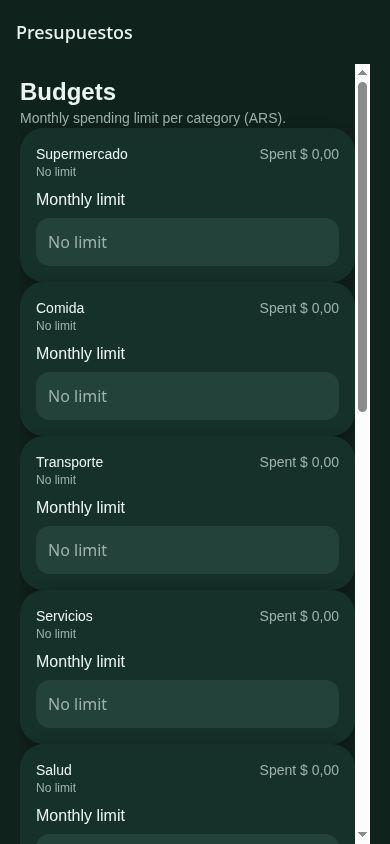
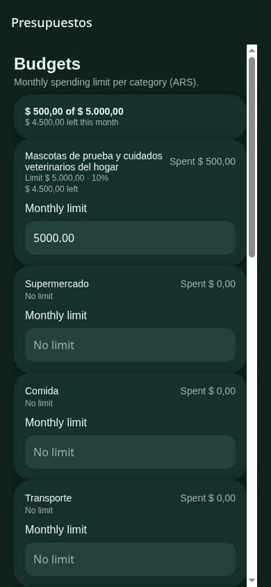

# Budgets with saved categories

Budgets now includes saved custom categories alongside the built-in expense categories. Category loading and failures participate in the existing loading, error and retry states. Long category names wrap without covering the spending amount. Leaving a limit field validates and saves through `onBlur`, which works in the web adapter as well as native TextInput.

## Manual verification

Checked the Expo web app at 390 × 844 with fictitious data on a separate local origin:

- Created a category and confirmed that it was missing from the original budget screen.
- Entered an invalid limit and saw validation feedback; corrected it to 5,000 ARS.
- Confirmed a 500 ARS test expense classified into the custom category.
- Reloaded Budgets: the saved limit remained 5,000 ARS, spending was 500 ARS (10%), and the monthly summary showed 4,500 ARS remaining.
- Renamed the category to a long label; the same budget and spending remained attached, and the name wrapped at mobile width.

The existing static web startup failed while prerendering the SQLite worker. Verification used a temporary single-page web configuration; the original app configuration was restored. Native keyboard/device behavior and a category-read failure were not exercised.

## Before

The saved custom category was absent; all built-in categories had no limit.

## After

The same custom category appears with a saved limit, spending and remaining balance. Its long name was tested by renaming it after creation. All shown data is fictitious.

